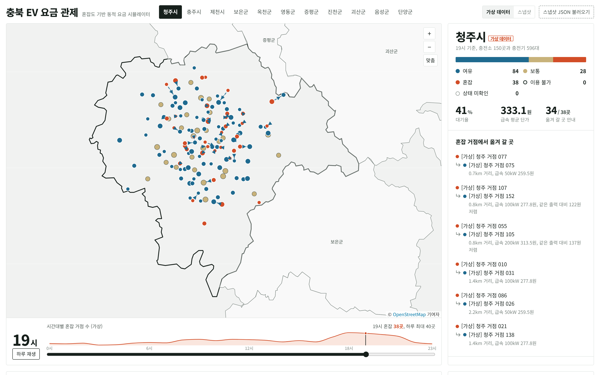
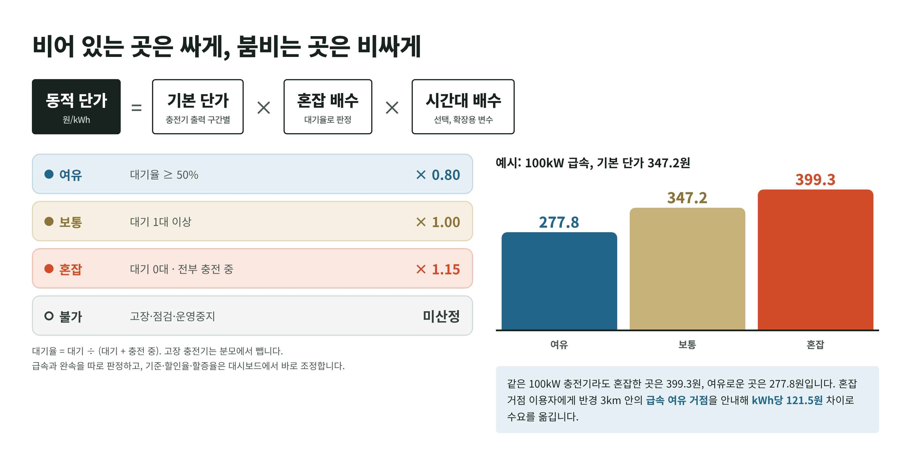
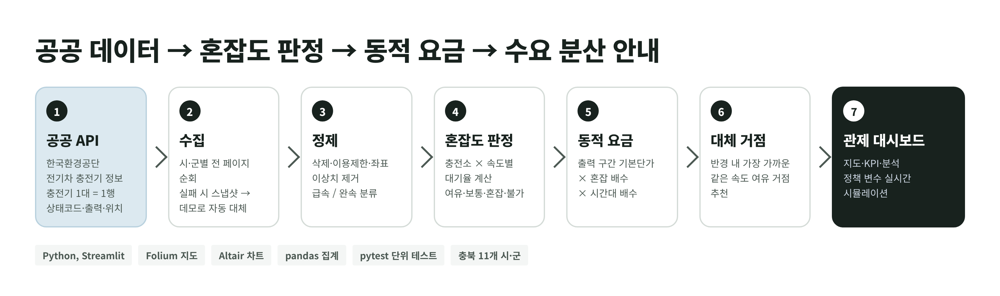
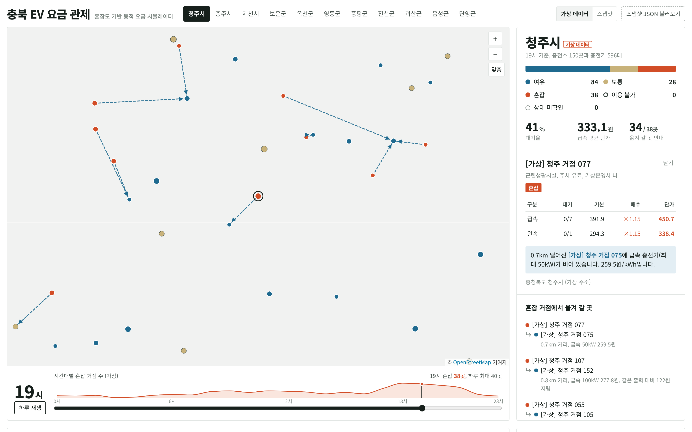
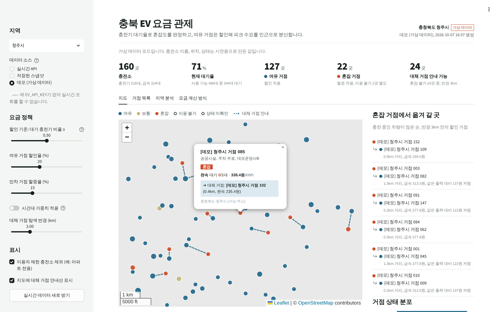
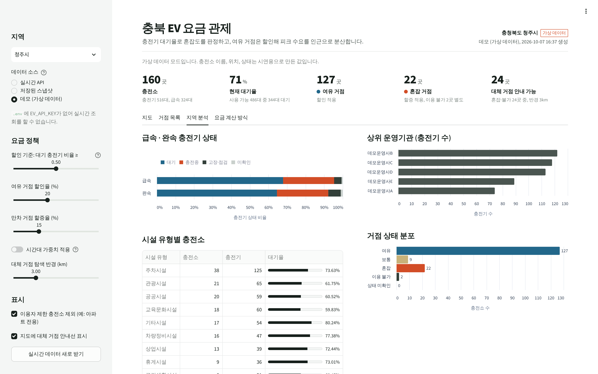
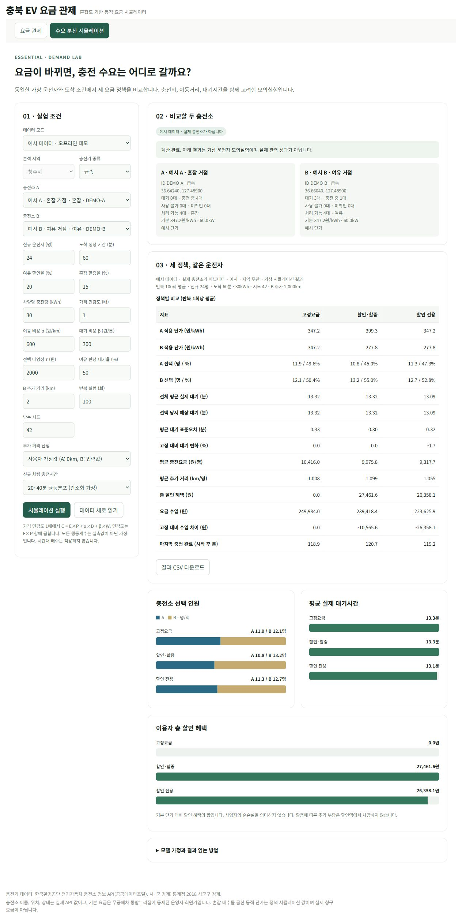

# 충북 EV 요금 관제

충전기 **대기율**로 충전소 혼잡도를 판정하고, 여유 거점은 할인하고 만차 거점은 할증하는 동적 요금을 매겨
피크 시간대 충전 수요를 **인근 유휴 거점으로 분산**하는 관제 서비스입니다.
한국환경공단 전기차 충전기 공공 API를 쓰며, 충청북도 11개 시·군을 지원합니다.

**공개 사이트: https://ev-hackathon.github.io/** (GitHub Pages, 15분마다 실제 데이터로 갱신)

| | 공개 사이트 (GitHub Pages) | 로컬 서버 (`server.py`) | 대시보드 앱 (`main.py`) |
|---|---|---|---|
| 용도 | 발표·포스터 QR, 팀 공유 | 개발·시연 (즉시 조회) | 분석·관제용 내부 도구 |
| 데이터 | GitHub Actions가 15분마다 수집한 실제 상태 + 기록 | 공공 API 즉시 조회 + 10분마다 기록 | 공공 API, 스냅샷, 가상 데이터 |
| 필요한 것 | 저장소 설정 한 번 (아래) | `.env`의 API 키 | `.env`의 API 키 |



<sub>※ 예전 버전(가상 데이터) 캡처입니다. 지금 사이트는 실제 API 데이터만 표시하며 OpenStreetMap 도로 지도 위에 그립니다.</sub>

---

## 핵심 아이디어

| 문제 | 해결 |
|---|---|
| 특정 충전소에만 차량이 몰리고, 몇 km 옆 충전소는 비어 있음 | 충전소별 실시간 대기율로 **여유 / 보통 / 혼잡 / 불가** 판정 |
| 요금이 혼잡과 무관하게 고정돼 분산 유인이 없음 | **동적 단가 = 운영사 실제 회원가(출력 구간) × 혼잡 배수 × 시간대 배수** |
| 이용자는 어디가 비었는지 모름 | 혼잡·불가 거점마다 반경 내 **같은 속도(급속/완속) 여유 거점**을 안내 |




## 주요 기능

- **수요 분산 시뮬레이션 탭**: 실제/예시 충전소 A/B, 로짓 선택 + FIFO 대기열, 세 정책 비교, 결과 CSV. 아래 실행·검증 안내 참고.

- **실시간 지도**: 충전소를 상태 색상으로 표시, 혼잡 → 대체 거점 안내선, 시·군 경계
- **KPI**: 충전소·충전기 수, 현재 대기율, 할인/혼잡 거점 수, 대체 거점 안내 가능 비율
- **정책 시뮬레이터**: 사이드바에서 할인 기준·할인율·할증율·시간대 가중치·탐색 반경을 바꾸면 즉시 재계산
- **거점 목록**: 상태 필터, 급속/완속별 대기·단가, CSV 다운로드
- **지역 분석**: 급속/완속 상태 비율, 운영기관 분포, 시설 유형별 대기율
- **오프라인 시연**: 실시간 API → 저장된 스냅샷 → 데모 데이터 순으로 자동 대체

| 웹사이트 충전소 상세 | 대시보드 앱 지도 | 지역 분석 |
|---|---|---|
|  |  |  |

---

## 웹사이트

### 공개 사이트 켜기 (GitHub Pages, 처음 한 번)

서버 없이 GitHub만으로 동작합니다. `.github/workflows/deploy.yml`이 15분마다
① 공공 API로 충북 전체 상태를 받아 ② `history` 브랜치에 기록을 쌓고 ③ 사이트와 데이터 파일을 Pages에 올립니다.
API 키는 GitHub Secret에만 있고 사이트에는 들어가지 않습니다.

1. 저장소 **Settings > Secrets and variables > Actions > New repository secret**
   이름 `EV_API_KEY`, 값은 공공데이터포털 인증키 (Decoding 키 권장)
2. **Settings > Pages > Build and deployment > Source**를 **GitHub Actions**로 바꿉니다.
3. **Actions** 탭 > **실제 데이터 사이트** > **Run workflow**로 한 번 실행합니다. 2~3분 뒤
   `https://<계정>.github.io/<저장소>/`에서 열립니다.

- 수집이 실패하면 사이트는 직전 기록으로 계속 열리고, Actions에 빨간 표시가 뜹니다. 실패 이유가 로그 맨 아래에 나옵니다.
- GitHub 예약 실행은 붐비는 시간에 몇 분~수십 분 늦게 돌 수 있습니다. 화면에 마지막 수집 시각이 표시됩니다.
- 공공데이터포털 개발계정은 하루 호출 한도가 있습니다. 수집 한 번에 2~3회 호출하므로 15분 주기면 하루 300회 안쪽입니다.

### 맥에서 바로 실행 (폰 주소 포함)

`run.command`를 더블클릭하면 서버와 폰·팀원용 인터넷 주소(trycloudflare.com)가 켜지고 주소가 `폰주소.txt`에 저장됩니다.
켜진 뒤에는 터미널 창을 닫아도 계속 돌아갑니다. 끌 때는 `stop.command`를 더블클릭하세요.
와이파이가 끊겨 주소가 죽으면 `scripts/tunnel_keeper.sh`가 몇 분 안에 새 주소를 띄우고 `폰주소.txt`와 사이트의 '폰으로 열기'를 고칩니다(바뀐 기록은 `tunnel_history.log`).
맥이 잠들거나 꺼지면 사이트도 멈추고, 무료 터널이라 주소는 바뀔 수 있습니다. 고정 주소가 필요하면 위의 GitHub Pages 방식을 쓰세요.

### 로컬 서버로 실행

```bash
pip install -r requirements.txt
cp .env.example .env              # EV_API_KEY 입력
python server.py                  # → http://localhost:8000
```

공공 API를 바로 부르고(5분 캐시), 켜 둔 동안 10분마다 `data/history/`에 기록합니다.
실패하면 `data/snapshots/`의 스냅샷으로 대체합니다. `render.yaml`로 Render에 올릴 수도 있습니다.

### 시간대별 기록

공공 API는 "지금 상태"만 줍니다. 하루 흐름은 위 수집이 쌓은 기록으로 보여줍니다.

- 수집 한 번에 충북 전체를 큰 페이지로 받아 시·군별로 나눕니다.
- 하루 첫 수집만 전체를 쓰고, 이후에는 상태가 바뀐 충전소만 덧붙입니다.
- 지나간 시각을 고르면 그 시각 기록으로 지도를 다시 그립니다. 시간 그래프에는 오늘 실측(실선)과 지난 7일 같은 시간대 평균(점선)이 나옵니다.
- 서버 없이 기록만 쌓으려면 `python -m scripts.collect --loop 10`.

### 파일로 열기

사이트는 실제 데이터만 표시합니다. `docs/index.html`을 파일로 바로 열면 데이터 서버가 없어 안내 문구만 나오므로, `run.command`(또는 `python server.py`)로 띄운 주소나 GitHub Pages 주소로 여세요.

### 사용법

- 상단에서 시·군을 고르거나 지도에서 다른 시·군을 누릅니다.
- 아래 시간 막대를 끌거나 **하루 재생**을 누르면 시간대별 혼잡 변화와 요금이 바뀝니다.
- 충전소 점을 누르면 급속·완속별 기본 단가, 배수, 동적 단가와 옮겨 갈 거점이 나옵니다.
- **새로 받기**로 최신 상태를 다시 받습니다. 5분마다 자동으로도 확인합니다.
- 지난 시각은 서버가 10분마다 쌓은 실측 기록으로 보여줍니다. 기록이 없는 시각은 '기록 없음'으로 표시합니다.
- 실시간 조회가 실패하면 서버에 마지막으로 저장된 실제 데이터를 **저장본** 표시와 함께 보여줍니다.

화면을 고칠 때는 `web/index.template.html`을 수정하고 `python -m scripts.build_web`으로 다시 빌드하세요.
요금 로직은 `utils/logic.py`를 그대로 옮긴 것이라, 정책 값을 바꾸면 두 곳을 함께 맞춰야 합니다.

## 대시보드 앱 실행

```bash
# 1) 패키지 설치 (Python 3.10+)
pip install -r requirements.txt

# 2) API 키 설정 — 공공데이터포털 '한국환경공단_전기자동차 충전소 정보' 활용신청 후 발급
cp .env.example .env          # Windows: copy .env.example .env
#    .env 파일에 EV_API_KEY=발급받은키 입력

# 3) 실행
streamlit run main.py
```

API 키가 없어도 **데모(가상 데이터)** 모드로 화면 전체를 확인할 수 있습니다.

### 발표장 오프라인 대비 (권장)

발표 전날 실제 데이터를 저장해 두면 네트워크가 없어도 실데이터로 시연할 수 있습니다.

```bash
python -m scripts.save_snapshot            # 충북 11개 시·군 전체 저장 → data/snapshots/
python -m scripts.save_snapshot 청주시      # 특정 지역만
```

앱 사이드바에서 **데이터 소스 → 저장된 스냅샷**을 선택하세요.

### 테스트

```bash
pytest          # 판정 규칙, 요금 계산, 대체 거점 추천, 페이지네이션, 서버 응답, 기록 저장·복원 등 44개 테스트
```

---

## 프로젝트 구조

```
├── server.py                # 웹사이트 서버: 사이트 제공, 실시간 데이터 중계, 10분마다 기록 (Flask)
├── .github/workflows/deploy.yml   # 15분마다 수집 → history 브랜치에 기록 → GitHub Pages 배포
├── render.yaml              # Render 배포 설정
├── main.py                  # Streamlit 대시보드 (사이드바, 탭 구성)
├── config.py                # ⚙️ 모든 정책 변수 · 코드표 · 지역 목록 (튜닝은 여기서)
├── utils/
│   ├── api.py               # 공공 API 수집 (페이지네이션 · 재시도 · 스냅샷)
│   ├── logic.py             # 정제 → 충전소 집계 → 혼잡 판정 → 동적 요금 → 대체 거점
│   ├── ui_components.py     # 지도 · KPI 카드 · 차트
│   ├── history.py           # 시간대별 상태 기록 저장·복원
│   ├── demo_data.py         # 오프라인 시연용 가상 데이터 생성
│   └── agent.py             # (확장 예정)
├── web/index.template.html  # 웹사이트 원본 (지도, 24시간 스크러버, 요금 시뮬레이터)
├── scripts/
│   ├── save_snapshot.py     # 실데이터 스냅샷 저장
│   ├── collect.py           # 상태 기록 수집기 (--loop로 반복)
│   ├── publish_static.py    # GitHub Pages용 사이트+데이터 빌드
│   └── build_web.py         # 웹사이트 빌드 → docs/index.html
├── data/
│   ├── chungbuk_sigungu.geojson   # 충북 시·군 경계 (지도 윤곽선)
│   └── snapshots/                 # 저장된 스냅샷
├── docs/
│   ├── index.html           # 빌드된 웹사이트 (GitHub Pages 공개용)
│   ├── images/              # README, 포스터용 이미지
│   └── figures/poster_figures.html  # 포스터 도식 원본 (브라우저로 열어 수정·캡처)
└── tests/                   # 로직·서버 테스트
```

## 알고리즘

1. **정제**: 삭제(`delYn=Y`)·이용자 제한(`limitYn=Y`, 선택)·좌표 이상치·중복 충전기를 제외하고, `chgerType`(코드 미상이면 출력 kW)으로 급속/완속을 분류합니다.
2. **대기율** = 대기(stat 2) ÷ (대기 + 충전중(stat 3)). 고장·점검(stat 1·4·5)은 분모에서 뺍니다.
3. **상태 판정** (급속·완속 각각, 그리고 충전소 전체)

   | 상태 | 조건 | 혼잡 배수(기본값) |
   |---|---|---|
   | 여유 | 대기율 ≥ 50% | × 0.80 |
   | 보통 | 대기 1대 이상 | × 1.00 |
   | 혼잡 | 대기 0대 (전부 충전 중) | × 1.15 |
   | 불가 | 사용 가능 충전기 없음 | 요금 미산정 |

4. **기본 단가**: 충전소 운영사의 실제 회원가. `data/operator_prices.csv`(무공해차 통합누리집 사업자별 요금 매트릭스, 102개 운영사 × 출력 5구간)를 충전기의 운영기관(busiNm)·출력(output)과 연결합니다(`utils/prices.py`). 구간이 비면 같은 운영사의 가장 가까운 구간, 운영사가 없으면 공공 요금(295~393.1원/kWh)
5. **대체 거점**: 혼잡·불가 거점에서 반경 R km 안의 가장 가까운, **같은 속도가 '여유'인** 거점

## 정책 변수 튜닝 (`config.py`)

| 변수 | 기본값 | 의미 |
|---|---|---|
| `PricingPolicy.discount_threshold` | 0.5 | 여유 판정 대기율 기준 |
| `PricingPolicy.discount_rate` | 0.20 | 여유 거점 할인율 |
| `PricingPolicy.surcharge_rate` | 0.15 | 혼잡 거점 할증율 |
| `PricingPolicy.use_time_of_day` / `time_bands` | 꺼짐 / 11~14시 ×0.90, 18~22시 ×1.05 | 시간대 가중치 (**예시 가정값**) |
| `BASE_RATE_TIERS` | 5단계 | 공공 요금 (운영사 요금 미등재 충전기용) |
| `REDIRECT_RADIUS_KM` | 3.0 | 대체 거점 탐색 반경 |
| `EXCLUDE_LIMITED_DEFAULT` | True | 아파트 전용 등 이용자 제한 충전소 제외 |
| `FAST_OUTPUT_KW` | 30 | 충전기 타입 미상 시 급속 판정 출력 |

사이드바 슬라이더의 초기값도 이 파일에서 읽습니다. 바뀐 값은 대시보드와 테스트에 그대로 반영됩니다.

## 데이터 출처 · 가정

- 충전기 데이터: 한국환경공단 전기자동차 충전소 정보 API (`getChargerInfo`, 공공데이터포털)
- 기본 단가: 무공해차 통합누리집(ev.or.kr) 충전요금 안내의 사업자별 요금 매트릭스(2026-10-19 수집). 운영사가 요금을 바꾸면 `data/operator_prices.csv`만 고치면 됩니다. 공공 요금은 기후에너지환경부 2026.8.1 시행 단가
- 코드표(`chgerType`, `stat`, `kind`): API 활용가이드 기준. 최신 가이드와 대조를 권장합니다
- 시·군 경계: 통계청 2018 시군구 경계 ([southkorea/southkorea-maps](https://github.com/southkorea/southkorea-maps)), 청주 4개 구 병합·단순화
- 지도: © OpenStreetMap contributors
- 화면의 요금은 **정책 시뮬레이션 값**이며 실제 청구 요금이 아닙니다

## 로드맵 (다음 대회 확장 아이디어)

- [x] **이력 수집**: 10~15분마다 상태 기록, 시간대별 실측 재생과 지난 7일 평균 (`utils/history.py`)
- [ ] **요일별 패턴**: 쌓인 기록으로 평일·주말을 나눈 혼잡 패턴
- [ ] **혼잡 예측**: 다음 1시간 대기율 예측 → 사전 할인(선제적 분산)
- [x] **수요 반응 시뮬레이션**: A/B 충전소에서 가상 운전자 로짓 선택·대기열과 세 정책 비교
- [ ] **배전망 연계**: 변전소·배전선로 단위 부하와 결합한 피크 저감 지표
- [ ] **시간대 요금 고도화**: 한전 계시별 요금·재생에너지 발전 피크 연동
- [ ] **이용자 측 추천**: 위치·잔여 배터리·이동 시간까지 고려한 최적 충전소 추천 (`utils/agent.py`)
- [ ] 충북 외 전국 시·도 확장 (`config.REGIONS`에 지역 추가)

## 보안 주의

`.env`(API 키)는 커밋하지 마세요. `.gitignore`에 포함돼 있습니다.
과거 커밋에 키가 올라간 적이 있다면 **공공데이터포털에서 키를 재발급**하세요. 파일을 지우는 것만으로는 히스토리에 남아 있습니다.

## 수요 분산 시뮬레이션 사용·검증

상단 **수요 분산 시뮬레이션** 버튼으로 진입합니다. 현재 기본 모드는 실제 공공데이터이며, 관제의 마지막 수집 상태를 재사용해 A/B를 자동 선택하고 좌표 직선거리를 적용합니다. 신규 24명/60분, 30kWh, 100회, 시드 42로 바로 실행할 수 있습니다. 예시 모드로 바꾸면 A 4대 충전 중, B 1대 충전 중/3대 빈 충전기, 양쪽 347.2원/kWh를 사용합니다. 예시를 기존 2km 가정으로 실험하려면 추가 거리 산정을 사용자 가정값으로 변경하세요. 처리 가능한 충전기가 없는 거점은 선택지에서 제외합니다. 데이터나 혼잡·여유 쌍이 없으면 이유를 안내하고 예시 모드를 직접 선택할 수 있습니다. 예시 모드의 지역은 적용하지 않습니다.



### 변경 파일과 빌드 흐름

| 파일 | 역할 |
|---|---|
| `web/index.template.html` | 관제/시뮬레이션 화면 전환과 실제 데이터 연결 인터페이스 |
| `web/simulation.js` | 브라우저/Node 공용 순수 계산 엔진, 시드 난수·정책·선택·대기열·반복 집계 |
| `web/simulation-ui.js` | 조건 입력, 실제/예시 선택, 표·막대그래프·CSV·오류·진행 상태 |
| `web/simulation.css` | 기존 색상과 어울리는 반응형 화면 |
| `scripts/build_web.py` | `config.DEFAULT_POLICY`와 지역 정보를 주입하고 JS/CSS를 HTML에 포함 |
| `docs/index.html` | 원본에서 다시 빌드한 GitHub Pages 및 Flask 공용 결과물 |
| `tests/simulation.test.cjs`, `tests/test_simulation_build.py` | 계산·관제 판정 일치·빌드·데이터 없는 환경 테스트 |
| `.gitignore` | 로컬 검증 패키지와 `_site` 산출물 제외 |

기존 `config.py`, `utils/logic.py`, `utils/history.py` 및 요금표를 확인했고, 기존 지도·검색·관제 요금 계산은 유지했습니다. `publish_static.build_site()`와 `server.py`는 공통 빌드를 그대로 사용합니다. JS/CSS를 빌드 시 HTML에 포함하므로 추가 정적 경로나 별도 서버 라우트를 배포할 필요가 없습니다.

### 계산 방식과 가정

1. 각 반복에서 운전자별 도착 시각, 20~40분 충전시간, 선택용 무작위 값 및 초기 차량 잔여시간을 한 번만 생성하고 세 정책이 공유합니다. 정책 순서나 선택 때문에 난수열이 바뀌지 않습니다.
2. `C = 가격민감도 × E × P + α × D + β × W`를 계산하고 최솟값을 뺀 안정적인 softmax로 A/B를 선택합니다. 기본 민감도 1, α=600원/km, β=300원/분, τ=2,000원입니다. 실측 행동계수가 아닙니다.
3. 혼잡 판정은 기존 `대기/(대기+충전 중)` 규칙과 동일합니다. 기본 임계값·할인·할증은 `config.DEFAULT_POLICY`에서 빌드 시 주입하며 관제 슬라이더와 시뮬레이션 입력은 독립적입니다. 각 충전소의 기본 단가에 정책 배수를 곱해 기존 관제처럼 소수 첫째 자리로 반올림합니다. 시작 상태로 요금을 고정하며 시간대 배수는 사용하지 않습니다.
4. 충전기별 다음 사용 가능 시각을 관리합니다. 도착순으로 가장 먼저 비는 충전기에 배정하여 FIFO 대기열을 구현합니다. 사용 불가·미확인 충전기는 제외하고, 초기 충전 차량은 0~30분 가정 잔여시간으로 점유합니다. 출력 모드는 `E/kW×60`분과 그 범위 내 초기 잔여시간을 사용합니다. 대표 출력은 기존 관제의 값을 재사용합니다.
5. 예상 대기는 선택 시점의 충전기 예약 현황, 실제 대기는 배정된 충전 시작 시각에서 각각 계산합니다. 동일한 정보·도착 즉시 선택·취소 없는 현재 모델에서는 일치합니다. 도착 기간 이후 완료되는 차량도 전부 집계합니다. 마지막 완료 시각은 반복별 마지막 완료의 평균입니다.
6. A는 원래 목적지(추가 0km), B는 사용자 가정값 또는 좌표 간 직선거리입니다. 도로 경로·이동 소요시간은 반영하지 않습니다. 충전 효율·충전곡선·출력 공유·혼합 출력의 개별 충전기 차이도 반영하지 않습니다.
7. 표와 CSV의 인원·할인 합계·수입 등은 **반복 1회당 평균**입니다. 대기 변화율은 `(정책 대기/고정 대기−1)×100`이며 고정 대기가 0이면 산정 불가로 표시합니다. 총 할인 혜택은 `Σ E×max(기본 단가−정책 단가,0)`이며 사업자 순손실이 아닙니다. 수입 차이는 선택 변화까지 반영한 단순 매출 비교입니다. 평균 대기 SE는 반복 간 변동으로 실제 예측 오차가 아닙니다.

### 로컬 실행

Python 3.10+와 Node.js 18+ 권장. 기존 서버 의존성을 설치하고 원본을 빌드합니다.

```sh
python -m pip install -r requirements-server.txt pytest
python -X utf8 -m scripts.build_web
python -m http.server 8000 --bind 127.0.0.1 --directory docs
```

브라우저에서 `http://127.0.0.1:8000`을 열고 시뮬레이션 탭에서 실행합니다. Python은 로컬 파일 제공에만 쓰이며 계산은 브라우저에서 실행됩니다. 예시는 `docs/index.html`을 직접 열어도 실행 가능합니다. 기존 지도는 CDN 라이브러리·지도 타일에 인터넷 연결이 필요합니다.

로컬에서 공개 사이트의 실제 저장본을 사용하려면 `python -X utf8 -m scripts.sync_public_data`를 실행하세요. 충북 11개 시·군 중 공개 수집 기록이 있는 지역을 `docs/data`로 내려받습니다. 공공 API 인증키는 사용하지 않으며 수집 시각을 그대로 표시합니다. 로컬 파일은 자동 수집되지 않으므로 최신 저장본이 필요하면 이 명령을 다시 실행하세요. 화면의 '데이터 새로 읽기'는 로컬 JSON을 다시 읽습니다. `docs/data`는 Git에서 제외하며 공개 배포에서는 기존 Actions가 데이터를 생성합니다.

기존에 수집한 기록이 있으면 아래 명령으로 실제 데이터가 포함된 정적 사이트를 만들 수 있습니다.

```sh
python -X utf8 -m scripts.publish_static --history data/history --out _site --no-collect
python -m http.server 8000 --bind 127.0.0.1 --directory _site
```

기존 실시간 Flask 실행 방식(`python server.py`)도 유지합니다. 키는 기존 서버/Actions 환경변수만 사용하며 시뮬레이션 코드에 넣지 않습니다.

### GitHub Pages 반영

로컬 변경을 검토한 뒤 원본 `web/**`, 빌드 스크립트, 테스트, README와 재생성한 `docs/index.html`을 커밋·푸시하면 기존 `.github/workflows/deploy.yml`의 경로 조건에 따라 `_site` 빌드 및 Pages 배포가 실행됩니다. Pages Source가 GitHub Actions인 현재 구조를 유지합니다. `/docs` 방식이라면 재빌드된 `docs/index.html`이 반영됩니다. 원본 저장소의 쓰기 권한이 없으면 개인 포크에 저장하고 변경 제안(PR)을 병합한 뒤 배포합니다.

### 테스트 명령과 확인 결과

```sh
node --test tests/simulation.test.cjs
python -m pytest -q --basetemp=.pytest_cache/simulation-run
```

- Node 12개 통과: 0% 정책 동일성, 시드 재현성, 사용 불가 제외(β=0 포함), 초기 만차 대기, FIFO/음수 대기 방지, 할인 전용 할증 없음, 서로 다른 기본 단가, 안정 softmax, 입력 검증, 출력 기반 시간, 회계 항등식, 명시적 예측 입력 인터페이스, 기존 관제 혼잡 판정 일치 및 빌드된 JS 문법 검사.
- Python 61개 통과: 기존 요금·상태·이력·서버 테스트와 신규 빌드 3개 포함. 임시 폴더 권한 문제를 피하도록 작업 폴더 안의 `--basetemp`를 지정했습니다.
- `publish_static --no-collect`로 데이터 없는 `_site` 빌드 성공. 별도 JS/CSS 누락 없이 단일 HTML에 포함됨을 확인했습니다.
- 브라우저에서 기본 실행·0% 재실행·UTF-8 BOM CSV 다운로드를 확인했습니다. 공개 사이트의 2026-11-02 11:00 청주시 저장본으로 기존 지도 964개 거점·2,851대 표시, 실제 급속 A/B 선택, 서로 다른 기본 단가(260/325원), 좌표 직선거리 적용 및 실행을 확인했습니다. 신규 실시간 공공 API 호출은 검증하지 않았습니다.
- 390×844 모바일에서 실행 후 페이지 가로 넘침 없음 확인(콘텐츠 폭 375px, 스크롤바 제외). PC 화면도 확인했습니다.

기본 예시 결과(100회/시드42): 고정요금 평균 대기 13.32분, 할인·할증 13.32분, 할인 전용 13.09분. 표시 반올림으로 앞의 두 값은 같지만 원시 값은 미세하게 다릅니다. 정책이 대기를 항상 줄이는 모델은 아니며 설정·반복 변동과 함께 해석해야 합니다.

### 확장 범위

할인율 스윕 그래프, 3개 이상 충전소, 시간 중 요금 재조정, 상세 과정 애니메이션, 강화학습, 실제 AI 예측 모델, 배전망 피크 계산은 구현하지 않았습니다. 외부 모델 예측 JSON 입력 UI와 요금 연동은 아래와 같이 지원합니다. 저수준 인터페이스 `ESSimulation.compare(stations, options, onProgress, utilizationById)`도 유지합니다. 같은 인터페이스를 Node에서는 `require('./web/simulation.js')`로 사용할 수 있습니다.

### 외부 AI 수요 예측 모델 연결

화면의 **요금 판정 기준 → 외부 AI 모델 예측 이용률**을 선택한 뒤 JSON 파일, 붙여넣기 또는 URL로 모델 출력을 입력합니다. 아직 실제 모델은 포함되어 있지 않으며, 화면이 예측값을 만들어 내지 않습니다.

출력 계약은 다음과 같습니다. 아래는 형식 설명용 틀이며, 시각·모델명·충전소 ID·이용률은 연결할 모델의 실제 출력으로 채워야 합니다.

```json
{
  "schema_version": 1,
  "model_name": "<모델 이름 및 버전>",
  "generated_at": "<시간대 포함 ISO 8601 생성 시각>",
  "target_time": "<시간대 포함 ISO 8601 예측 대상 시각>",
  "predictions": [
    {"station_id": "<충전소 A ID>", "speed": "fast", "utilization": 0.8},
    {"station_id": "<충전소 B ID>", "speed": "fast", "utilization": 0.2}
  ]
}
```

- `speed`: 급속 `fast`, 완속 `slow`. 선택된 A/B의 종류와 ID가 일치해야 합니다.
- `utilization`: 가동 가능한 충전기 중 충전 중인 비율(0~1). 사용 불가·미확인은 분모에서 제외합니다. 위 0.8/0.2는 형식 설명용 수치이며 실제 예측이 아닙니다.
- 생성·대상 시각은 `2026-11-02T16:00:00+09:00`처럼 시간대를 포함합니다. 대상은 생성 시각 이후이면서 실행 시점보다 미래여야 합니다. 중복, 누락, 범위 오류, 지난 대상 시각이면 실행을 차단합니다. 미래 생성 시각은 5분 이내 시계 오차만 허용합니다.
- 기본 여유 기준 50%에서는 예측 이용률 50% 이하면 여유, 50% 초과~100% 미만이면 보통, 100%면 혼잡입니다. 기존 정책 규칙을 그대로 적용하므로 이용률 90%를 자동으로 할증하지 않습니다.
- 예측은 **정책 요금 산정에만 반영**합니다. 초기 점유·충전 능력은 수집 데이터 그대로이며, 미래 시점의 전체 대기열이나 미래 신규 운전자 수를 예측 이용률에서 만들어 내지 않습니다. 외부 모델의 예상 도착 인원을 자동 적용하는 기능은 아직 없습니다.
- 정책별 고정 단가, 모델명, 생성/대상 시각 및 적용한 A/B 예측 이용률을 결과/CSV에 남깁니다. 기간 중 요금 재조정은 하지 않습니다.

자동화하려면 외부 모델 작업이 `data/forecast.json`을 생성하도록 구성하세요. `scripts.build_web`와 `scripts.publish_static`이 이 파일을 사이트의 `data/forecast.json`으로 복사하며, 예측 파일만 변경한 경우에는 기존 예약 배포를 기다리거나 Actions에서 수동 실행하세요. 배포 후 화면에서 기본 URL `data/forecast.json`을 불러올 수 있습니다. 모델이 별도 서비스라면 공개 JSON URL을 입력할 수 있으나 CORS 허용이 필요합니다. 브라우저에 API 키를 넣는 방식은 지원하지 않습니다. 인증이 필요한 모델은 서버나 Actions에서 추론 후 공개 가능한 결과만 JSON으로 내보내세요.

이번 추가 검증: Node 14개, Python 63개 통과. 예측 누락·중복·종류 불일치·만료·범위 오류 차단, 예측에 따른 단가·선택 변화, 초기 점유와 고정요금 기준 유지, 선택적 예측 파일 배포 포함 및 실제 저장본 동기화를 검증했습니다. 브라우저에서는 실제 청주시 A/B와 **연동 검증용 가정값(실제 AI 예측 아님)**을 사용해 예측 기준 단가 변화를 확인했습니다.

### 공유 주소

`http://127.0.0.1:8000`은 접속하는 사람 자신의 PC를 가리키므로 다른 사람에게 보내도 이 사이트를 볼 수 없습니다. 최신 변경을 검토한 뒤 기존 저장소에 푸시하고 GitHub Pages Actions 배포가 성공하면 `https://ev-hackathon.github.io/#simulation`을 공유할 수 있습니다. 이 주소는 시뮬레이션 탭을 바로 엽니다. 각 방문자는 기본 조건에서 시작하며, 현재 입력값이나 업로드한 예측 JSON이 주소에 저장되지는 않습니다. 동일 결과를 공유할 때는 CSV를 함께 전달하세요. 개인 포크에 저장하는 것만으로 원본 공개 사이트가 갱신되지는 않습니다. 원본 관리자의 PR 병합이 필요합니다.
