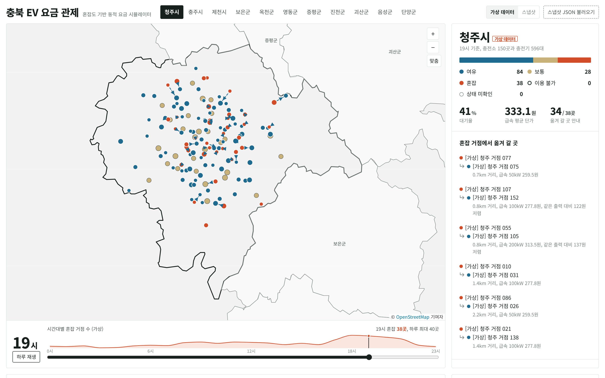
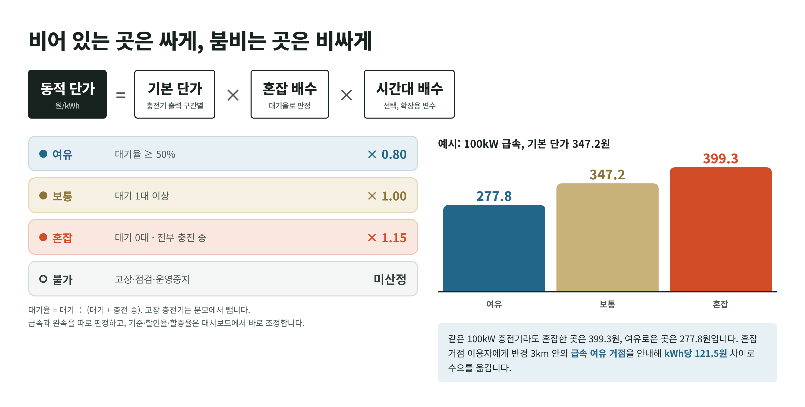
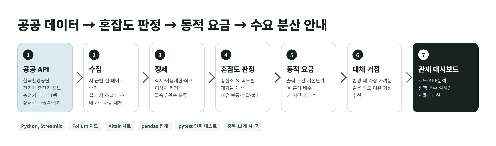
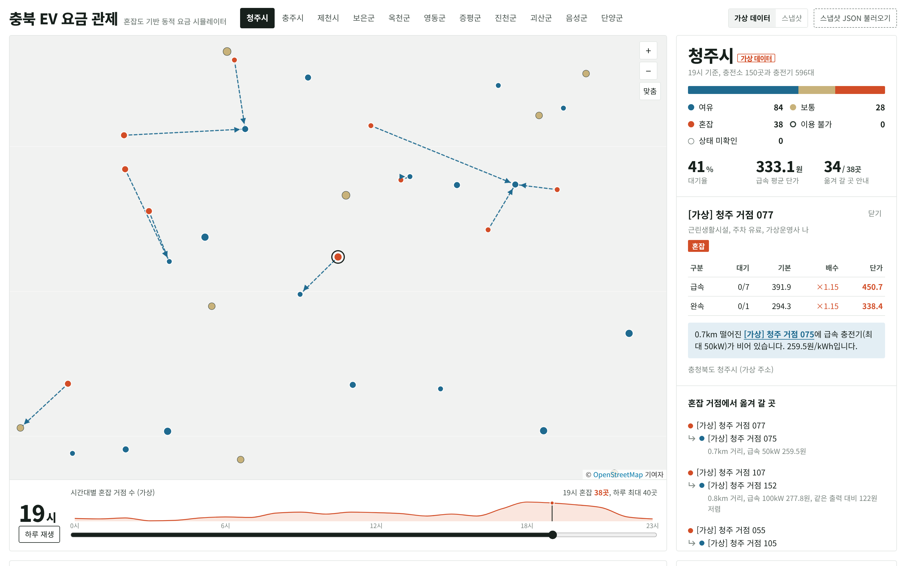
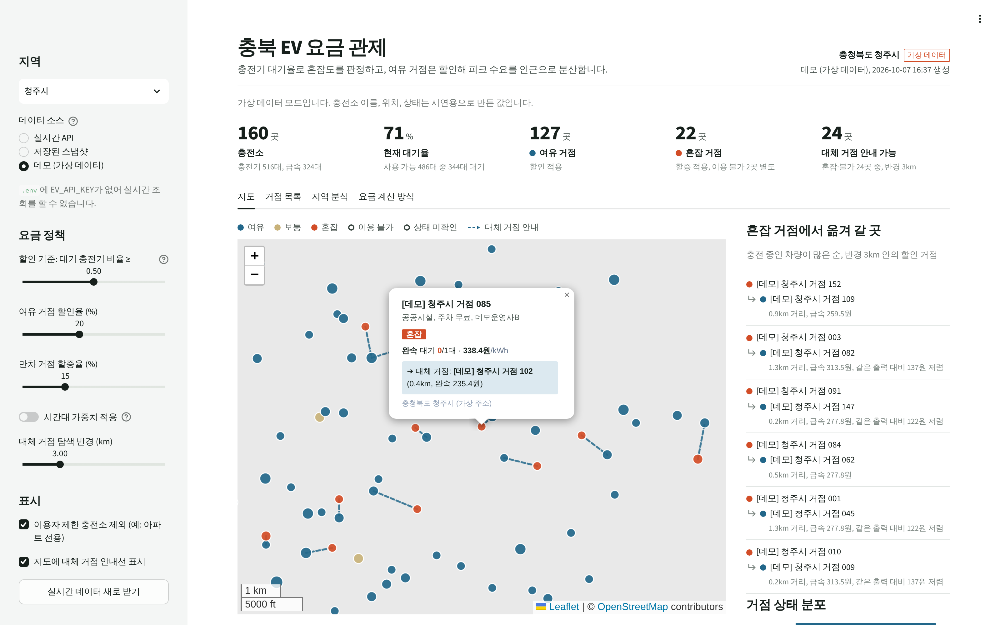
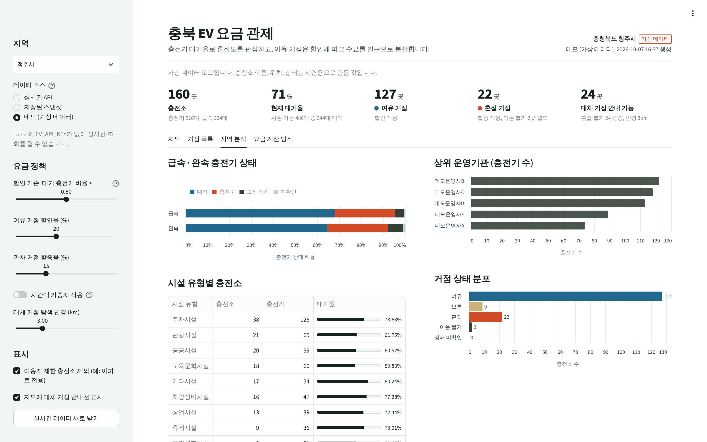

# 충북 EV 요금 관제

충전기 **대기율**로 충전소 혼잡도를 판정하고, 여유 거점은 할인하고 만차 거점은 할증하는 동적 요금을 매겨
피크 시간대 충전 수요를 **인근 유휴 거점으로 분산**하는 관제 서비스입니다.
한국환경공단 전기차 충전기 공공 API를 쓰며, 충청북도 11개 시·군을 지원합니다.

**공개 사이트: https://guligae158-lgtm.github.io/chungbuk-ev/** (GitHub Pages, 15분마다 실제 데이터로 갱신)

| | 공개 사이트 (GitHub Pages) | 로컬 서버 (`server.py`) | 대시보드 앱 (`main.py`) |
|---|---|---|---|
| 용도 | 발표·포스터 QR, 팀 공유 | 개발·시연 (즉시 조회) | 분석·관제용 내부 도구 |
| 데이터 | GitHub Actions가 15분마다 수집한 실제 상태 + 기록 | 공공 API 즉시 조회 + 10분마다 기록 | 공공 API, 스냅샷, 가상 데이터 |
| 필요한 것 | 저장소 설정 한 번 (아래) | `.env`의 API 키 | `.env`의 API 키 |



<sub>※ 예전 버전(가상 데이터) 캡처입니다. 지금 사이트는 실제 API 데이터만 표시하며 OpenStreetMap 도로 지도 위에 그립니다.</sub>

---

## 핵심 아이디어

| 문제 | 해결 |
|---|---|
| 특정 충전소에만 차량이 몰리고, 몇 km 옆 충전소는 비어 있음 | 충전소별 실시간 대기율로 **여유 / 보통 / 혼잡 / 불가** 판정 |
| 요금이 혼잡과 무관하게 고정돼 분산 유인이 없음 | **동적 단가 = 기본 단가(출력 구간) × 혼잡 배수 × 시간대 배수** |
| 이용자는 어디가 비었는지 모름 | 혼잡·불가 거점마다 반경 내 **같은 속도(급속/완속) 여유 거점**을 안내 |




## 주요 기능

- **실시간 지도**: 충전소를 상태 색상으로 표시, 혼잡 → 대체 거점 안내선, 시·군 경계
- **KPI**: 충전소·충전기 수, 현재 대기율, 할인/혼잡 거점 수, 대체 거점 안내 가능 비율
- **정책 시뮬레이터**: 사이드바에서 할인 기준·할인율·할증율·시간대 가중치·탐색 반경을 바꾸면 즉시 재계산
- **거점 목록**: 상태 필터, 급속/완속별 대기·단가, CSV 다운로드
- **지역 분석**: 급속/완속 상태 비율, 운영기관 분포, 시설 유형별 대기율
- **오프라인 시연**: 실시간 API → 저장된 스냅샷 → 데모 데이터 순으로 자동 대체

| 웹사이트 충전소 상세 | 대시보드 앱 지도 | 지역 분석 |
|---|---|---|
|  |  |  |

---

## 웹사이트

### 공개 사이트 켜기 (GitHub Pages, 처음 한 번)

서버 없이 GitHub만으로 동작합니다. `.github/workflows/deploy.yml`이 15분마다
① 공공 API로 충북 전체 상태를 받아 ② `history` 브랜치에 기록을 쌓고 ③ 사이트와 데이터 파일을 Pages에 올립니다.
API 키는 GitHub Secret에만 있고 사이트에는 들어가지 않습니다.

1. 저장소 **Settings > Secrets and variables > Actions > New repository secret**
   이름 `EV_API_KEY`, 값은 공공데이터포털 인증키 (Decoding 키 권장)
2. **Settings > Pages > Build and deployment > Source**를 **GitHub Actions**로 바꿉니다.
3. **Actions** 탭 > **실제 데이터 사이트** > **Run workflow**로 한 번 실행합니다. 2~3분 뒤
   `https://<계정>.github.io/<저장소>/`에서 열립니다.

- 수집이 실패하면 사이트는 직전 기록으로 계속 열리고, Actions에 빨간 표시가 뜹니다. 실패 이유가 로그 맨 아래에 나옵니다.
- GitHub 예약 실행은 붐비는 시간에 몇 분~수십 분 늦게 돌 수 있습니다. 화면에 마지막 수집 시각이 표시됩니다.
- 공공데이터포털 개발계정은 하루 호출 한도가 있습니다. 수집 한 번에 2~3회 호출하므로 15분 주기면 하루 300회 안쪽입니다.

### 맥에서 바로 실행 (폰 주소 포함)

`run.command`를 더블클릭하면 서버와 폰·팀원용 인터넷 주소(trycloudflare.com)가 켜지고 주소가 `폰주소.txt`에 저장됩니다.
켜진 뒤에는 터미널 창을 닫아도 계속 돌아갑니다. 끌 때는 `stop.command`를 더블클릭하세요.
와이파이가 끊겨 주소가 죽으면 `scripts/tunnel_keeper.sh`가 몇 분 안에 새 주소를 띄우고 `폰주소.txt`와 사이트의 '폰으로 열기'를 고칩니다(바뀐 기록은 `tunnel_history.log`).
맥이 잠들거나 꺼지면 사이트도 멈추고, 무료 터널이라 주소는 바뀔 수 있습니다. 고정 주소가 필요하면 위의 GitHub Pages 방식을 쓰세요.

### 로컬 서버로 실행

```bash
pip install -r requirements.txt
cp .env.example .env              # EV_API_KEY 입력
python server.py                  # → http://localhost:8000
```

공공 API를 바로 부르고(5분 캐시), 켜 둔 동안 10분마다 `data/history/`에 기록합니다.
실패하면 `data/snapshots/`의 스냅샷으로 대체합니다. `render.yaml`로 Render에 올릴 수도 있습니다.

### 시간대별 기록

공공 API는 "지금 상태"만 줍니다. 하루 흐름은 위 수집이 쌓은 기록으로 보여줍니다.

- 수집 한 번에 충북 전체를 큰 페이지로 받아 시·군별로 나눕니다.
- 하루 첫 수집만 전체를 쓰고, 이후에는 상태가 바뀐 충전소만 덧붙입니다.
- 지나간 시각을 고르면 그 시각 기록으로 지도를 다시 그립니다. 시간 그래프에는 오늘 실측(실선)과 지난 7일 같은 시간대 평균(점선)이 나옵니다.
- 서버 없이 기록만 쌓으려면 `python -m scripts.collect --loop 10`.

### 파일로 열기

사이트는 실제 데이터만 표시합니다. `docs/index.html`을 파일로 바로 열면 데이터 서버가 없어 안내 문구만 나오므로, `run.command`(또는 `python server.py`)로 띄운 주소나 GitHub Pages 주소로 여세요.

### 사용법

- 상단에서 시·군을 고르거나 지도에서 다른 시·군을 누릅니다.
- 아래 시간 막대를 끌거나 **하루 재생**을 누르면 시간대별 혼잡 변화와 요금이 바뀝니다.
- 충전소 점을 누르면 급속·완속별 기본 단가, 배수, 동적 단가와 옮겨 갈 거점이 나옵니다.
- **새로 받기**로 최신 상태를 다시 받습니다. 5분마다 자동으로도 확인합니다.
- 지난 시각은 서버가 10분마다 쌓은 실측 기록으로 보여줍니다. 기록이 없는 시각은 '기록 없음'으로 표시합니다.
- 실시간 조회가 실패하면 서버에 마지막으로 저장된 실제 데이터를 **저장본** 표시와 함께 보여줍니다.

화면을 고칠 때는 `web/index.template.html`을 수정하고 `python -m scripts.build_web`으로 다시 빌드하세요.
요금 로직은 `utils/logic.py`를 그대로 옮긴 것이라, 정책 값을 바꾸면 두 곳을 함께 맞춰야 합니다.

## 대시보드 앱 실행

```bash
# 1) 패키지 설치 (Python 3.10+)
pip install -r requirements.txt

# 2) API 키 설정 — 공공데이터포털 '한국환경공단_전기자동차 충전소 정보' 활용신청 후 발급
cp .env.example .env          # Windows: copy .env.example .env
#    .env 파일에 EV_API_KEY=발급받은키 입력

# 3) 실행
streamlit run main.py
```

API 키가 없어도 **데모(가상 데이터)** 모드로 화면 전체를 확인할 수 있습니다.

### 발표장 오프라인 대비 (권장)

발표 전날 실제 데이터를 저장해 두면 네트워크가 없어도 실데이터로 시연할 수 있습니다.

```bash
python -m scripts.save_snapshot            # 충북 11개 시·군 전체 저장 → data/snapshots/
python -m scripts.save_snapshot 청주시      # 특정 지역만
```

앱 사이드바에서 **데이터 소스 → 저장된 스냅샷**을 선택하세요.

### 테스트

```bash
pytest          # 판정 규칙, 요금 계산, 대체 거점 추천, 페이지네이션, 서버 응답, 기록 저장·복원 등 44개 테스트
```

---

## 프로젝트 구조

```
├── server.py                # 웹사이트 서버: 사이트 제공, 실시간 데이터 중계, 10분마다 기록 (Flask)
├── .github/workflows/deploy.yml   # 15분마다 수집 → history 브랜치에 기록 → GitHub Pages 배포
├── render.yaml              # Render 배포 설정
├── main.py                  # Streamlit 대시보드 (사이드바, 탭 구성)
├── config.py                # ⚙️ 모든 정책 변수 · 코드표 · 지역 목록 (튜닝은 여기서)
├── utils/
│   ├── api.py               # 공공 API 수집 (페이지네이션 · 재시도 · 스냅샷)
│   ├── logic.py             # 정제 → 충전소 집계 → 혼잡 판정 → 동적 요금 → 대체 거점
│   ├── ui_components.py     # 지도 · KPI 카드 · 차트
│   ├── history.py           # 시간대별 상태 기록 저장·복원
│   ├── demo_data.py         # 오프라인 시연용 가상 데이터 생성
│   └── agent.py             # (확장 예정)
├── web/index.template.html  # 웹사이트 원본 (지도, 24시간 스크러버, 요금 시뮬레이터)
├── scripts/
│   ├── save_snapshot.py     # 실데이터 스냅샷 저장
│   ├── collect.py           # 상태 기록 수집기 (--loop로 반복)
│   ├── publish_static.py    # GitHub Pages용 사이트+데이터 빌드
│   └── build_web.py         # 웹사이트 빌드 → docs/index.html
├── data/
│   ├── chungbuk_sigungu.geojson   # 충북 시·군 경계 (지도 윤곽선)
│   └── snapshots/                 # 저장된 스냅샷
├── docs/
│   ├── index.html           # 빌드된 웹사이트 (GitHub Pages 공개용)
│   ├── images/              # README, 포스터용 이미지
│   └── figures/poster_figures.html  # 포스터 도식 원본 (브라우저로 열어 수정·캡처)
└── tests/                   # 로직·서버 테스트
```

## 알고리즘

1. **정제**: 삭제(`delYn=Y`)·이용자 제한(`limitYn=Y`, 선택)·좌표 이상치·중복 충전기를 제외하고, `chgerType`(코드 미상이면 출력 kW)으로 급속/완속을 분류합니다.
2. **대기율** = 대기(stat 2) ÷ (대기 + 충전중(stat 3)). 고장·점검(stat 1·4·5)은 분모에서 뺍니다.
3. **상태 판정** (급속·완속 각각, 그리고 충전소 전체)

   | 상태 | 조건 | 혼잡 배수(기본값) |
   |---|---|---|
   | 여유 | 대기율 ≥ 50% | × 0.80 |
   | 보통 | 대기 1대 이상 | × 1.00 |
   | 혼잡 | 대기 0대 (전부 충전 중) | × 1.15 |
   | 불가 | 사용 가능 충전기 없음 | 요금 미산정 |

4. **기본 단가**: 충전기 출력 구간별 공공 충전요금 5단계(30kW 미만 294.3원 ~ 200kW 이상 391.9원/kWh)
5. **대체 거점**: 혼잡·불가 거점에서 반경 R km 안의 가장 가까운, **같은 속도가 '여유'인** 거점

## 정책 변수 튜닝 (`config.py`)

| 변수 | 기본값 | 의미 |
|---|---|---|
| `PricingPolicy.discount_threshold` | 0.5 | 여유 판정 대기율 기준 |
| `PricingPolicy.discount_rate` | 0.20 | 여유 거점 할인율 |
| `PricingPolicy.surcharge_rate` | 0.15 | 혼잡 거점 할증율 |
| `PricingPolicy.use_time_of_day` / `time_bands` | 꺼짐 / 11~14시 ×0.90, 18~22시 ×1.05 | 시간대 가중치 (**예시 가정값**) |
| `BASE_RATE_TIERS` | 5단계 | 출력 구간별 기본 단가 |
| `REDIRECT_RADIUS_KM` | 3.0 | 대체 거점 탐색 반경 |
| `EXCLUDE_LIMITED_DEFAULT` | True | 아파트 전용 등 이용자 제한 충전소 제외 |
| `FAST_OUTPUT_KW` | 30 | 충전기 타입 미상 시 급속 판정 출력 |

사이드바 슬라이더의 초기값도 이 파일에서 읽습니다. 바뀐 값은 대시보드와 테스트에 그대로 반영됩니다.

## 데이터 출처 · 가정

- 충전기 데이터: 한국환경공단 전기자동차 충전소 정보 API (`getChargerInfo`, 공공데이터포털)
- 기본 단가: 2026년 4월 공공 충전요금 5단계 개편 행정예고(언론 보도 기준). **시행일·최종 단가는 공식 고시로 확인 후 `config.py` 수정**
- 코드표(`chgerType`, `stat`, `kind`): API 활용가이드 기준. 최신 가이드와 대조를 권장합니다
- 시·군 경계: 통계청 2018 시군구 경계 ([southkorea/southkorea-maps](https://github.com/southkorea/southkorea-maps)), 청주 4개 구 병합·단순화
- 지도: © OpenStreetMap contributors
- 화면의 요금은 **정책 시뮬레이션 값**이며 실제 청구 요금이 아닙니다

## 로드맵 (다음 대회 확장 아이디어)

- [x] **이력 수집**: 10~15분마다 상태 기록, 시간대별 실측 재생과 지난 7일 평균 (`utils/history.py`)
- [ ] **요일별 패턴**: 쌓인 기록으로 평일·주말을 나눈 혼잡 패턴
- [ ] **혼잡 예측**: 다음 1시간 대기율 예측 → 사전 할인(선제적 분산)
- [ ] **수요 반응 시뮬레이션**: 할인율별 이동 확률(가격 탄력성) 가정으로 분산 효과 정량화
- [ ] **배전망 연계**: 변전소·배전선로 단위 부하와 결합한 피크 저감 지표
- [ ] **시간대 요금 고도화**: 한전 계시별 요금·재생에너지 발전 피크 연동
- [ ] **이용자 측 추천**: 위치·잔여 배터리·이동 시간까지 고려한 최적 충전소 추천 (`utils/agent.py`)
- [ ] 충북 외 전국 시·도 확장 (`config.REGIONS`에 지역 추가)

## 보안 주의

`.env`(API 키)는 커밋하지 마세요. `.gitignore`에 포함돼 있습니다.
과거 커밋에 키가 올라간 적이 있다면 **공공데이터포털에서 키를 재발급**하세요. 파일을 지우는 것만으로는 히스토리에 남아 있습니다.
